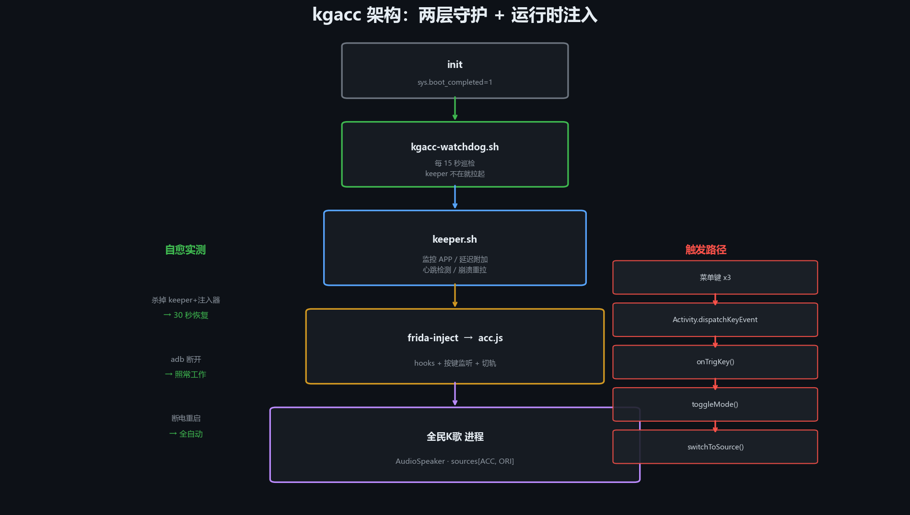

# kgacc — 全民K歌 TV 伴唱/原唱实时切换

> 遥控器连按 3 次「菜单」键，在**伴唱**与**原唱**之间实时切换，MV 画面不中断、音画同步。

<p align="center">
  
</p>

---

## 这个项目解决什么问题

全民K歌 TV 版（`com.tencent.karaoketv`）自带「原唱/伴唱」开关，但多数机型上：

- 开关藏得深，遥控器要点好几层
- 部分版本切了不生效（装配没刷新）
- 切完音画不同步（音频从头播，视频还在原时间轴）

本项目通过 Frida 运行时注入，把切换做成**一键直达**：

| | |
|---|---|
| 触发 | 遥控器连按 3 次「菜单」键（2.5 秒内） |
| 反馈 | Toast：`KG: ACCOMPANY` / `KG: ORIGINAL` |
| 效果 | 音轨实时换槽，MV 不停、音画同步 |
| 自启 | 开机自动生效，无需任何手动操作 |

---

## 核心原理

### 双音轨架构

播放器内部维护 `sources` 列表（`AudioSource` 数组）和 `currentSource` 游标：

```
槽 0 = Audio_ACC_*   伴唱（纯伴奏）
槽 1 = Audio_ORI_*   原唱（带人声）
```

两个槽必须是**不同文件**，`switchToSource(idx, true)` 才有意义。

### 切换链路

```
菜单键 x3
  └─ onTrigKey()          计数达标
      └─ toggleMode()     写 acc_mode
          └─ rebuildPlayer()
              ├─ switchToSource(SLOT_ACC|SLOT_ORI, true)
              └─ Toast 提示
```

**关键：不清空 `sources`。**

早期版本用 `sources.clear()` + `setDataSources()` 重建，会导致：

1. 音频从零开始，视频轨继续走原时间轴 → **音画不同步**
2. 播放器直接停播 —— `com.tencent.qqmusicsdk.player.a` 里没有 `start()/play()/resume()`，恢复不了

### 装配保证

`setDataSources` 钩子强制把数组补成 `[ACC, ORI]`：

```javascript
patched = Java.array('java.io.File', [accFile, oriFile]);
```

否则应用有时会装成 `[ACC,ACC]` 或 `[ORI,ORI]`，那种情况切槽等于没切。

### 反调试对抗

K歌 用腾讯乐固（`libjiagu.so`）+ FireEye（`libFireEye-rqd.so`）。后者在 `wns_recver` 线程周期性扫 `/proc/self/maps`，发现 `frida-agent` 就 `kill()` 自己（`SIGSEGV code 0 SI_USER`）。

对策两层：

1. **延迟附加** —— 等 `mResumedActivity` 出现后再注入
2. **拦截自杀信号** —— hook `kill/tgkill/raise/pthread_kill/abort/_exit/exit`，仅当调用栈含 `FireEye`/`jiagu` 时拦截，其他放行

---

## 架构

```
开机
 └─ init 读 /system/etc/init/kgacc.rc
     └─ kgacc-watchdog.sh        每 15 秒巡检，保证 keeper 活着
         └─ keeper.sh            监控 APP、延迟附加、心跳检测、崩溃重拉
             └─ frida-inject -p PID -s acc.js
                 └─ acc.js       挂钩 + 按键监听 + 切轨
```

两层守护的效果（实测）：

| 场景 | 结果 |
|---|---|
| 杀掉 keeper + 注入器 | 30 秒内自动恢复 |
| adb 断开 | 盒子照常工作 |
| 断电重启 | 全自动恢复 |

---

## 安装

### 前置条件

- Android TV 盒子，**已 root**（Magisk / SuperSU 均可）
- 已开启 ADB 调试
- 已安装全民K歌 TV 版（`com.tencent.karaoketv`）

### 步骤

```bash
git clone https://github.com/toxicbeef/kgacc.git
cd kgacc

# 1. 下载注入器（因体积大不入库）
bash scripts/fetch-frida.sh

# 2. 推送并安装
adb push src/* scripts/* /sdcard/kgacc/
adb shell su 0 sh /sdcard/kgacc/install.sh
```

Windows 用户直接双击 `scripts/install.bat`。

### 安装器参数

```bash
install.sh                    # 安装
install.sh --status           # 查看状态
install.sh --uninstall        # 完全卸载
install.sh --pkg com.xxx      # 指定包名
install.sh --dir /path        # 指定输出目录
install.sh --no-boot          # 不装开机自启
```

---

## 使用

1. 打开全民K歌，点一首歌开始播放
2. 遥控器**连按 3 次「菜单」键**
3. 屏幕出现 Toast，声音在伴唱/原唱之间切换

### 换触发键

```bash
# 查看当前
adb shell su 0 cat /data/local/tmp/kg/acc_key

# 改成方向键下 + OK（逗号分隔 = 任一触发）
adb shell su 0 sh -c 'echo -n "20,23" > /data/local/tmp/kg/acc_key'
```

常用 keyCode：

| 值 | 键 |
|---|---|
| 82 | 菜单 |
| 23 | OK |
| 19/20/21/22 | 上/下/左/右 |
| 4 | 返回 |
| 176 | 设置 |

---

## 运维

```bash
D=/data/local/tmp/kg

cat $D/acc_state      # 心跳
cat $D/acc_mode       # 当前模式
touch $D/acc_toggle   # 手动切一次
touch $D/acc_off      # 暂停注入（rm 恢复）
tail -f $D/acc_v9.log # 实时日志
```

### 日志关键字

| 关键字 | 含义 |
|---|---|
| `KEY cnt=N` | 按键计数 |
| `TOGGLE -> acc/ori` | 模式切换 |
| `DS-FORCE [ACC,ORI]` | 双轨装配成功 |
| `DS-IN n=2 :: ACC:xxx , ORI:yyy` | 装配入参（xxx≠yyy 才对） |
| `RB switchToSource(0/1,true)` | 槽位切换 |
| `KEY hooks armed` | 按键通道就绪 |

---

## 故障排查

| 现象 | 原因 | 处理 |
|---|---|---|
| 按 3 次无反应 | 按键没进 `Activity.dispatchKeyEvent` | 换 keyCode |
| 切了但声音不变 | 两槽装了同一文件 | 查日志有无 `DS-FORCE` |
| 完全没有声音 | 媒体音量为 0 | `media volume --stream 3 --set 1` |
| 没有 Toast | `toggleMode` 没执行 | 查日志有无 `TOGGLE` |
| 心跳消失 | agent 崩溃 | 等 30 秒，watchdog 会拉起 |
| `sync up with agent` 超时 | 旧 agent 残留 | `am force-stop` 后重开 |

---

## 兼容性

### 已验证

| 项 | 值 |
|---|---|
| 设备 | 创维 E900V22F |
| 系统 | Android 9 / SDK 28 / armeabi-v7a |
| SELinux | Permissive |
| 应用 | 全民K歌 TV 5.9.0.1 / 6.4.4 |

### 可移植设计

代码里没有写死任何机型信息：

1. **包名** —— 自动取 `currentPackageName()`，`$KGACC_PKG` 可覆盖
2. **目录** —— `$KGACC_DIR` > `/data/local/tmp/kg` > `/data/local/tmp/kgacc` > app 私有目录，逐个试写
3. **类名** —— `CLASSES` 候选表 + `J()/JN()`，混淆名变了只加一行
4. **触发键** —— `acc_key` 文件配置
5. **槽位语义** —— `CFG.SLOT_ACC/SLOT_ORI` 可反转

换机型先跑 `scripts/detect.sh`，它会报告 root / SELinux / 分区可写性 / 应用状态，直接给出能否安装的判定。

---

## 已知限制

- **需要 root** —— 运行时注入依赖 ptrace，无 root 不可行
- **不适用华为智慧屏** —— bootloader 锁定、SELinux Enforcing、系统分区只读，三重阻断
- **不适用手机版** —— `com.tencent.karaoke` 的 477 个 Activity 全按触屏设计，无 DPAD 焦点体系，遥控器走不通
- **加固版本需适配** —— 腾讯乐固壳会随版本变化，类名变动时需更新 `CLASSES`

---

## 免责声明

仅供**个人学习与自用设备研究**。使用者需自行承担：

- 设备保修失效的风险
- 应用服务条款相关的风险
- 任何因使用本工具产生的后果

本项目**不分发**任何腾讯的 APK、加固壳或受版权保护的资源。注入器（Frida）请从官方渠道获取。

---

## License

MIT
